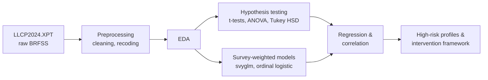

# Social Determinants of Mental Health in the United States


An empirical analysis of how loneliness, emotional support, and life satisfaction shape poor mental health days among US adults, using the **2024 Behavioral Risk Factor Surveillance System (BRFSS)** across the **33 states** that administered the optional Social Determinants module.

**Headline result:** social factors predict poor mental health more strongly than traditional demographics, and loneliness is the strongest modifiable risk factor.

---

## Research questions

1. Do social determinants predict poor mental health days more strongly than demographic factors?
2. Which population subgroups are at the highest risk of poor mental health?
3. What evidence-based interventions can address the identified drivers?

## Pipeline



## Methods

| Analysis | Purpose |
|---|---|
| Survey-weighted design (`survey` package) | Population-representative estimates using BRFSS sampling weights |
| t-tests (standard and survey-weighted) | Differences by sex and depression diagnosis |
| One-way ANOVA + Tukey HSD | Differences across loneliness, emotional support, life satisfaction, income, and age levels |
| Spearman correlation | Monotonic association between each predictor and poor mental health days |
| Multiple linear regression | Joint effect of depression, loneliness, life satisfaction, emotional support, sex, age, income, and smoking |
| Ordinal logistic regression with odds ratios | Poor mental health days binned into 4 levels, modeled against income, age, smoking, and loneliness |
| Survey-weighted chi-square test | Association between sex and high-risk mental health status |
| Joint Wald test | Whether the block of social variables adds explanatory power while holding demographics constant |
| Bonferroni-adjusted pairwise comparisons | Controlled multiple comparisons between group means |

## Key findings

| Finding | Evidence |
|---|---|
| Social determinants outperform demographics | Spearman r for loneliness above 0.4, versus 0.27 for age |
| Loneliness is the strongest modifiable risk factor | ANOVA F > 1000, every Tukey pair significant |
| Emotional support is protective | Negative coefficient in the multiple regression |
| Depression diagnosis has the largest effect | Largest coefficient among all regression predictors |
| Young adults are the highest-risk age group | Ages 18 to 34 report the most poor mental health days |
| Income gradient is consistent | All 10 income-level pairs significant in Tukey HSD (p < 0.001) |
| Women report more poor mental health days | About 1.4 more days per month, significant t-test |

These findings feed a **three-tier intervention framework** (policy, clinical, community), a **priority matrix** ranking interventions by impact and feasibility, and **state-level policy recommendations**.

## Limitations

- **Cross-sectional data:** associations, not causation. Loneliness and poor mental health likely influence each other.
- **Self-reported measures:** subject to recall and social desirability bias.
- **33-state sample:** only states that ran the Social Determinants module, so results don't generalize to the whole US.
- **Right-skewed count outcome:** OLS is a simplification; Poisson or negative binomial models are a natural next step.
- **Missing income data (16.5%):** multiple imputation could improve precision.

## Repository structure

```
├── Preprocessing.Rmd           # Load raw BRFSS, clean and recode variables
├── EDA.Rmd                     # Distributions and descriptive statistics
├── Statistical-Inference.Rmd   # Survey-weighted tests, ordinal models, odds ratios, Wald test
├── Research.Rmd                # Full research paper: hypothesis tests, regression, solutions framework
├── DS Project.Rmd
└── reports/                    # Knitted PDFs, project proposal, discussion paper
```

## Reproducing the analysis

The raw data (about 1 GB) is not included in this repository.

1. Download the **2024 BRFSS annual data (SAS Transport format)** from the [CDC BRFSS annual data page](https://www.cdc.gov/brfss/annual_data/annual_data.htm).
2. Unzip it and place `LLCP2024.XPT` in the project root.
3. Open `Data Science Project.Rproj` in RStudio.
4. Knit the notebooks in order: `Preprocessing.Rmd`, `EDA.Rmd`, `Statistical-Inference.Rmd`, `Research.Rmd`.

## Team

Team project, Northeastern University, Spring 2026.

**Aaditya Singh** · **Meghana** · **Priyamvada Jha** · **Itesha Rathod** · **Keerthana Lokesh**
